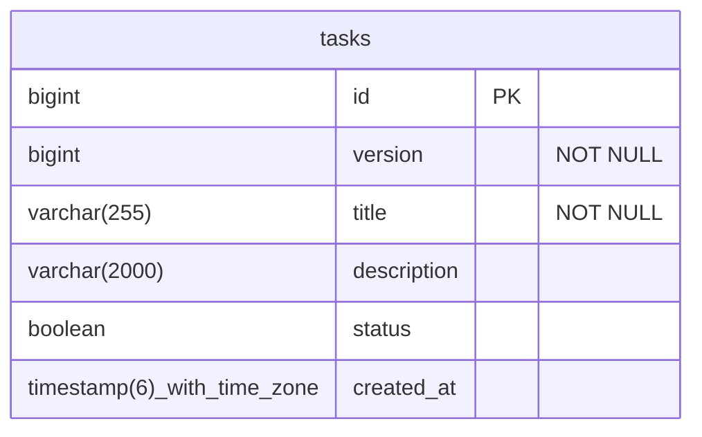
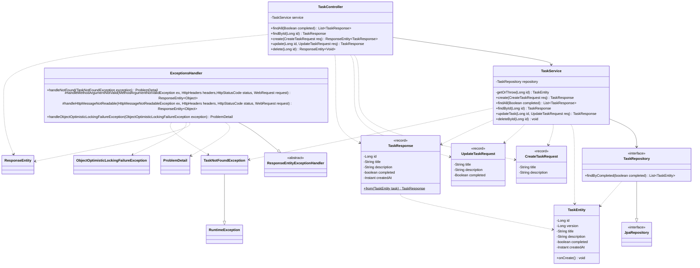

# Бэкенд-приложение для управления задачами

REST API для создания, просмотра, изменения и удаления задач с фильтрацией по статусу выполнения.

## Стек технологий

- **Java 25**
- **Spring Boot 4**
- **Spring Data JPA** (Hibernate)
- **H2 Database** (in-memory)
- **Bean Validation**
- **REST API** с обменом данными в формате **JSON**
- **Swagger** (springdoc-openapi)
- **Postman**

___

## ER-Диаграмма



## Диаграмма классов



## Запуск

**Требования:** JDK 25. Устанавливать Maven не нужно, в проект включён Maven Wrapper.

```bash
mvnw.cmd spring-boot:run
```

Приложение запускается на порту **8080**: `http://localhost:8080`.

> База данных хранится в памяти, поэтому при каждом перезапуске она создаётся заново и пуста.

## Документация и инструменты

### Swagger UI

`http://localhost:8080/swagger-ui.html`

Описание всех эндпоинтов, моделей запросов и ответов, возможных кодов ошибок. Запросы можно отправлять прямо со страницы.

### H2 Console

`http://localhost:8080/h2-console`

| Параметр | Значение |
|---|---|
| JDBC URL | `jdbc:h2:mem:taskmanagerdb` |
| User Name | `sa` |
| Password | *(пусто)* |

### Postman

Коллекция лежит в папке `postman/collections`. В ней есть запросы ко всем эндпоинтам и автотесты, проверяющие коды ответов и тело ответа, включая ошибочные сценарии (400, 404). Есть также проверка на ошибку 409, однако без создания искусственной задержки в коде при изменении записи проверить её не получится (проверка была проведена и результат был корректен)

___

## Эндпоинты

| Метод | URL | Описание | Успех | Ошибки |
|---|---|---|---|---|
| `POST` | `/tasks` | Создать задачу | 201 + заголовок `Location` | 400 |
| `GET` | `/tasks` | Получить все задачи | 200 | |
| `GET` | `/tasks?completed=true` | Получить задачи с фильтром по статусу | 200 | 400 |
| `GET` | `/tasks/{id}` | Получить задачу по `id` | 200 | 404 |
| `PATCH` | `/tasks/{id}` | Частично изменить задачу | 200 | 400, 404, 409 |
| `DELETE` | `/tasks/{id}` | Удалить задачу | 204 | 404 |


## Формат ошибок

Все ошибки возвращаются в формате **ProblemDetail**.

Пример ответа `404 Not Found`:

```json
{
  "type": "about:blank",
  "title": "Задача не найдена",
  "status": 404,
  "detail": "Задача с id 42 не найдена",
  "instance": "/tasks/42"
}
```

| Код | Когда возникает |
|---|---|
| 400 | Тело запроса не прошло валидацию, некорректный JSON или неверный тип параметра |
| 404 | Задача с указанным `id` не существует |
| 409 | Задачу одновременно изменил другой пользователь |

___

## Архитектура

Приложение разделено на три слоя: `Controller`, `Service` и `Repository`.
Также выделены отдельные пакеты для DTO (`dto`), сущности (`model`) и обработки ошибок (`exception`).

```
HTTP-запрос → TaskController → TaskService → TaskRepository → H2
```

### Controller

**Название класса:** `TaskController`

Класс принимает HTTP-запросы, передаёт данные в сервис и возвращает HTTP-ответы с нужным кодом.
Помечен аннотацией `@RestController`, поэтому Spring создаёт его как бин, а возвращаемые объекты сериализуются в JSON.
Для описания эндпоинтов в Swagger используются аннотации `@Operation` (описание операции) и `@ApiResponse` (возможные коды ответов).
Для привязки методов к HTTP-запросам используются `@GetMapping`, `@PostMapping`, `@PatchMapping` и `@DeleteMapping`.

### Service

**Название класса:** `TaskService`

Класс содержит бизнес-логику: создание задачи из `CreateTaskRequest`, изменение задачи из `UpdateTaskRequest`, получение и удаление задач.
Помечен аннотацией `@Service`, все операции выполняются в транзакциях (`@Transactional`).
В контроллер возвращает только `TaskResponse`, сущность `TaskEntity` за пределы сервиса не выходит.

### Repository

**Название класса:** `TaskRepository`

Интерфейс для работы с БД, наследуется от `JpaRepository`. Реализацию методов (`save`, `findById`, `findAll`, `deleteById` и т. д.) Spring Data создаёт автоматически.
Для фильтрации по статусу используется производный метод `findByCompleted`.
Отдельного метода для изменения нет: изменения сущности внутри транзакции сохраняются автоматически (dirty checking).

### DTO

**Названия классов:** `CreateTaskRequest`, `UpdateTaskRequest` и `TaskResponse`

`CreateTaskRequest` и `UpdateTaskRequest` описывают тело входящих запросов. Внутри стоят аннотации валидации `@NotBlank` и `@Size`, которые проверяются благодаря `@Valid` в контроллере.
`TaskResponse` описывает тело ответа. Благодаря этому сущность не выходит наружу, и клиент получает только нужные поля.

### Entity

**Название класса:** `TaskEntity`

Сущность, представляющая запись в таблице БД. Аннотация `@Entity` сообщает Hibernate, что класс отображается на таблицу, а `@Table` задаёт имя этой таблицы. Таблица создаётся автоматически при запуске (`ddl-auto: create-drop`).

| Поле | Аннотации | Описание |
|---|---|---|
| `Long id` | `@Id`, `@GeneratedValue` | Первичный ключ, значение генерирует БД |
| `Long version` | `@Version` | Оптимистическая блокировка: при одновременном изменении задачи второе изменение отклоняется с кодом 409, а не затирает первое |
| `String title` | `@NotBlank`, `@Column` | Не может быть пустым или `null`, максимальная длина 255 |
| `String description` | `@Column` | Может быть пустым или `null`, максимальная длина 2000 |
| `boolean completed` | `@Column` | Не может быть `null`, так как поле примитивного типа |
| `Instant createdAt` | `@Column` | Время создания задачи в UTC |

Кроме геттеров и сеттеров, у сущности есть метод `onCreate` с аннотацией `@PrePersist`. Он вызывается автоматически перед вставкой новой записи в БД и записывает в `createdAt` текущее время в UTC.

### Exception

**Названия классов:** `TaskNotFoundException`, `ExceptionsHandler`

`TaskNotFoundException` наследуется от `RuntimeException` и выбрасывается, когда задача с указанным `id` не найдена. Обработчик превращает её в ответ 404.

`ExceptionsHandler` наследуется от `ResponseEntityExceptionHandler` и помечен аннотацией `@RestControllerAdvice`. Он перехватывает ошибки и возвращает их в формате `ProblemDetail` с понятным описанием на русском языке. Методы:

- `handleTaskNotFound`: аннотация `@ExceptionHandler(TaskNotFoundException.class)`, возвращает 404;
- `handleMethodArgumentNotValid`: переопределённый метод родителя, возвращает 400 и список полей с ошибками, когда тело запроса не прошло валидацию (`title` пустой или отсутствует при создании, превышена максимальная длина);
- `handleHttpMessageNotReadable`: переопределённый метод родителя, возвращает 400, когда тело запроса не удаётся прочитать (синтаксически некорректный JSON, `"completed": "abc"`);
- `handleObjectOptimisticLockingFailureException`: аннотация `@ExceptionHandler(ObjectOptimisticLockingFailureException.class)`, возвращает 409, когда задачу одновременно изменил другой пользователь.

___

## Возможные улучшения

- PostgreSQL вместо H2 и миграции схемы через Flyway (`ddl-auto: validate`)
- Автотесты: `@WebMvcTest` для контроллера, `@DataJpaTest` для репозитория, интеграционные тесты на Testcontainers
- Пагинация списка задач (`Pageable`)
- Передача версии клиенту через заголовки `ETag` / `If-Match`
- Docker Compose для запуска приложения вместе с БД одной командой
